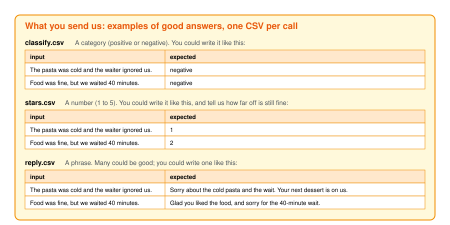

# noesis-quickstart

Noesis finds the cheapest model that still gives the answers you expect, for each LLM call in your
app, and keeps it up to date as new models come out.

## What "optimize" means here

Two words we use throughout:

- **Your current model**: the LLM your app calls today, often a frontier model like Gemini or Claude.
- **Candidate models**: the cheaper open models we test in its place.

Your app makes a few LLM calls, and each one could use any of dozens of models. With 4 calls and 20
candidate models, that's 20 × 20 × 20 × 20 = 160,000 possible setups. Nobody can try them all by hand.

To **optimize** is to search those setups for the best one that reaches a goal without breaking a rule:

- **Goal:** pay as little as possible.
- **Rule:** the answers stay as good as you expect.

Cost is easy to measure. "As good as you expect" isn't: only you know what a good answer looks like in
your app. So before we can search, you show us, with examples. That's step 2.

## The mock app

This repo uses a made-up app to show what that takes. It reads a restaurant review, **classifies** it
as positive or negative, guesses its **stars** from 1 to 5, then **writes a reply** to the customer:
three LLM calls, one for each kind of answer (a category, a number, a phrase).

Each call gets a short name, an **alias**, written `<app>/<task>`: here `demo/classify`, `demo/stars`
and `demo/reply`. Your app asks for the alias instead of a model name, and Noesis decides which model
answers it.


## 1. Point your app at Noesis

Where your app calls an LLM, change two things: `base_url` and `model`.

```python
client = OpenAI(base_url="https://noesis.mirai-engineering.com/v1", api_key=NOESIS_API_KEY)

client.chat.completions.create(model="demo/classify", messages=[...])   # frontier model was: model="gemini-2.5-flash"
client.chat.completions.create(model="demo/stars", messages=[...])      # frontier model was: model="gemini-2.5-flash"
client.chat.completions.create(model="demo/reply", messages=[...])      # frontier model was: model="claude-opus-5-5"
```

That's it. The alias never changes; the model behind it does, when we find a better one.

## 2. Show us what a good answer looks like

A computer can't guess what "good" means for your app; you have to show it. It's the same idea used to
train chat assistants: people show what a good answer is, and the model learns from it. Here nothing
gets trained. Your examples become the test every candidate model has to pass.

Send us one CSV file per LLM call. Each row has what your app sends to your current model (`input`)
and the answer you expect back (`expected`).



- **A category**, like positive or negative: write the one you expect, as in
  [`data/classify.csv`](data/classify.csv).
- **A number**, like a star rating: write the one you expect, as in [`data/stars.csv`](data/stars.csv),
  and tell us how far off is still fine (here: 1 star).
- **A phrase**, like a reply to a customer: many could be good, so write one you would be happy to
  send, as in [`data/reply.csv`](data/reply.csv). You can also paste one your current model wrote, if
  you're happy with it.

Also send us **your prompts**, and the order your app runs the calls in (here: classify, stars, reply).
We run your app's steps with each candidate model, so we need them as they are.

Is your input more than a sentence, like a JSON record or an image? Or is your answer structured,
like JSON? See [`examples/`](examples/).

## 3. How we turn your examples into a score

For each candidate model, we run your inputs through your app's steps and compare its answer with the
one you expected. Each answer gets a score from 0 (bad) to 1 (good). Engineers call the rule that gives
this score an `eval_fn`. You don't write it; we build it from your examples.

- **A category** (`classify`): is the candidate's answer the same as yours?

  ```python
  def eval_fn(expected, answer):
      return 1.0 if answer.strip().lower() == expected else 0.0
  ```

- **A number** (`stars`): how far off is it? Exact scores 1, one star off scores 0.5, further scores 0.

  ```python
  def eval_fn(expected, answer):
      return max(0.0, 1 - abs(int(answer) - int(expected)) / 2)
  ```

- **A phrase** (`reply`): the words will differ, so we check what matters instead. Does the
  candidate's reply apologise for the same problem yours does? Another LLM reads both replies and
  judges that.

Each review then gets one score: by default the average of the three. If one call matters more to
you, say so and it counts more.

Then we keep the cheapest models whose answers score as well as yours, and point your aliases at them.
When new models come out, we run the search again.

## Your data

Used only to find models for you, kept on our side, never shared with anyone, deleted when you ask.
