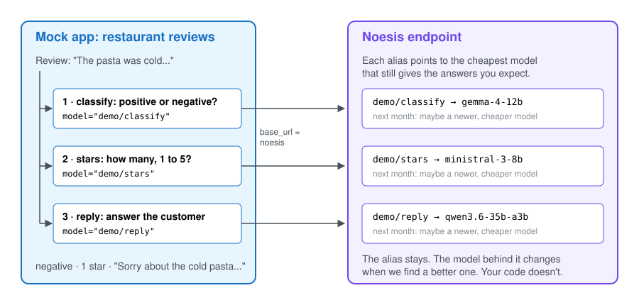
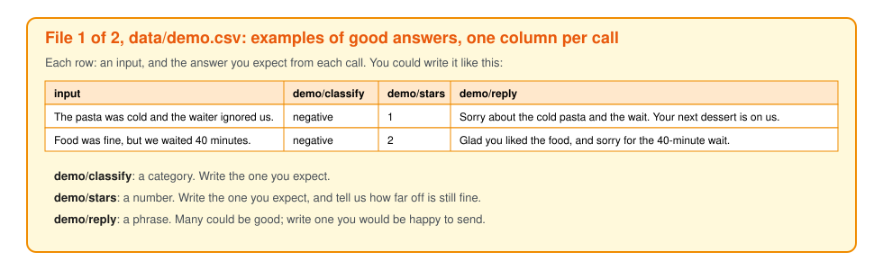
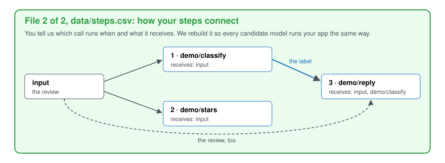

# noesis-quickstart

Noesis finds the cheapest model that still gives the answers you expect, for each LLM call in your
app, and keeps it up to date as new models come out.

**What you do, in short:**

1. Change two things in your app: `base_url` and the model name (step 1).
2. Send us **two CSV files** (step 2). This repo has the mock app's version of both in [`data/`](data/);
   yours have the same columns:
   - [`data/demo.csv`](data/demo.csv): examples of good answers, one row per example.
   - [`data/steps.csv`](data/steps.csv): your prompts and how your LLM calls chain, one row per call.

Everything else in this repo explains how to fill in those two files.

## What "optimize" means here

Two words we use throughout:

- **Your current model**: the LLM your app calls today, often a frontier model like Gemini or Claude's Sonnet.
- **Candidate models**: the cheaper open models we test in its place (that still do the job).

Your app makes a few LLM calls, and each one could use any of dozens of models. With 4 calls and 20
candidate models, that's 20 × 20 × 20 × 20 = 160,000 possible setups. Nobody can try them all by hand.

To **optimize** is to search those setups for the best one that reaches a goal without breaking a rule:

- **Goal:** pay as little as possible.
- **Rule:** the answers stay as good as you expect.

Cost is easy to measure. "As good as you expect" isn't: only you know what a good answer looks like in
your app. So before we can search, you show us, with examples. That's step 2.

## The mock app

This repo uses a made-up app to show what that takes. It reads a restaurant review, **classifies** it
as positive or negative, guesses its **stars** from 1 to 5, then **writes a reply** to the customer:
three LLM calls, one for each kind of answer (a category, a number, a phrase).

Each call gets a short name, an **alias**, written `<app>/<task>`: here `demo/classify`, `demo/stars`
and `demo/reply`. Your app asks for the alias instead of a model name, and Noesis decides which model
answers it.



## 1. Point your app at Noesis

Where your app calls an LLM, change two things: `base_url` and `model`.

```python
client = OpenAI(base_url="https://noesis.mirai-engineering.com/v1", api_key=NOESIS_API_KEY)

client.chat.completions.create(model="demo/classify", messages=[...])   # frontier model was: model="gemini-2.5-flash"
client.chat.completions.create(model="demo/stars", messages=[...])      # frontier model was: model="gemini-2.5-flash"
client.chat.completions.create(model="demo/reply", messages=[...])      # frontier model was: model="claude-opus-5-5"
```

That's it. The alias never changes; the model behind it does, when we find a better one.

## 2. Show us what a good answer looks like

A computer can't guess what "good" means for your app; you have to show it. It's the same idea used to
train chat assistants: people show what a good answer is, and the model learns from it. Here nothing
gets trained. Your examples become the test every candidate model has to pass.

You send us two CSV files. The mock app's versions are in [`data/`](data/); name yours as you like.

| File | What's in it | One row per |
|---|---|---|
| [`data/demo.csv`](data/demo.csv) | examples: an input, and the answer you expect from each call | example |
| [`data/steps.csv`](data/steps.csv) | your prompts, and what each call receives | LLM call |

### File 1 of 2: `data/demo.csv`, examples of good answers

Each row is one example: what goes into your app (`input`), then one column per LLM call, named after
its alias, with the answer you expect from your current model at that step.



- **A category**, like positive or negative (`demo/classify`): write the one you expect.
- **A number**, like a star rating (`demo/stars`): write the one you expect, and tell us how far off is
  still fine (here: 1 star).
- **A phrase**, like a reply to a customer (`demo/reply`): many could be good, so write one you would be
  happy to send. You can also paste one your current model wrote, if you're happy with it.

The whole file for the mock app is [`data/demo.csv`](data/demo.csv).

Is your input more than a sentence, like a JSON record or an image? Or is your answer structured,
like JSON? It still goes in these two CSV files; [`examples/`](examples/) shows how.

#### How many examples?

About **20 rows to get started**, and **50 to 100** before you rely on the result. Twenty already
separates clearly better models from clearly worse ones; more examples separate the close ones. Pick
them like your real traffic: mostly typical cases, plus a few hard ones.

The temptation to just let your coding agent do this for you is there. But please, review on your own
at least 5 examples per call. Then let your agent either get the rest from your app's real traffic, 
or let it generate the rest of the examples. Then check them yourself. The results of Noesis can be
only as good as the steering users give it.

### File 2 of 2: `data/steps.csv`, your prompts and the order of the calls

A model's answer depends on two things: the **instructions** your app gives it (the prompt) and the
**data**. File 1 holds the data; the **prompts** live in your code. To test a candidate
model fairly, it has to get exactly the instructions your current model gets. Otherwise we would be
testing our prompt, not the model.

Your prompts stay yours. We use them only to test candidate models on your real app, never for
anything else, and we never share them.

The **order** matters because calls often feed each other. In the mock app, the reply step receives the
label from the classify step, so a candidate that gets the label wrong also spoils the reply. You tell
us the order and what each step receives; we rebuild your steps to run exactly like your app, and test
every candidate model that way.



You write all of this in `data/steps.csv`, one row per LLM call. The prompts usually show how calls
chain, but it's often hidden in code; a table where you say it is clearer for both of us. For the mock
app, you could write it like this ([`data/steps.csv`](data/steps.csv)):

| step | alias | prompt | receives | settings |
|---|---|---|---|---|
| 1 | `demo/classify` | Is this restaurant review positive or negative? Reply with one word. | input | temperature=0 |
| 2 | `demo/stars` | How many stars, from 1 to 5, did this reviewer give? Reply with the number only. | input | temperature=0 |
| 3 | `demo/reply` | Reply to this {demo/classify} restaurant review in at most two sentences. | input, demo/classify | temperature=0 |

- **prompt**: as it is in your code. Where it uses an earlier step's answer, write that step's alias
  in braces, like `{demo/classify}`.
- **receives**: `input`, and the alias of every earlier step whose answer this one uses.
- **settings**: anything you pass with the call (temperature, maximum length), or leave it empty.

## 3. How we turn your examples into a score

For each candidate model, we run the inputs from `data/demo.csv` through your steps from
`data/steps.csv`, and compare its answer with the one you expected. Each answer gets a score from 0 (bad) to 1 (good). Engineers call the rule that gives
this score an `eval_fn`. You don't write it; we build it from your examples.

- **A category** (`demo/classify`): is the candidate's answer the same as yours?

  ```python
  def eval_fn(expected, answer):
      return 1.0 if answer.strip().lower() == expected else 0.0
  ```

- **A number** (`demo/stars`): how far off is it? Exact scores 1, one star off scores 0.5, further scores 0.

  ```python
  def eval_fn(expected, answer):
      return max(0.0, 1 - abs(int(answer) - int(expected)) / 2)
  ```

- **A phrase** (`demo/reply`): the words will differ, so we check what matters instead. Does the
  candidate's reply apologise for the same problem yours does? Another LLM reads both replies and
  judges that.

Each review then gets one score: by default the average of the three. If one call matters more to
you, say so and it counts more.

Then we keep the cheapest models whose answers score as well as yours, and point your aliases at them.
When new models come out, we run the search again.

## Your data

Used only to find models for you, kept on our side, never shared with anyone, deleted when you ask.
The same goes for your prompts: they stay yours, and we use them only to test candidate models on
your app.
